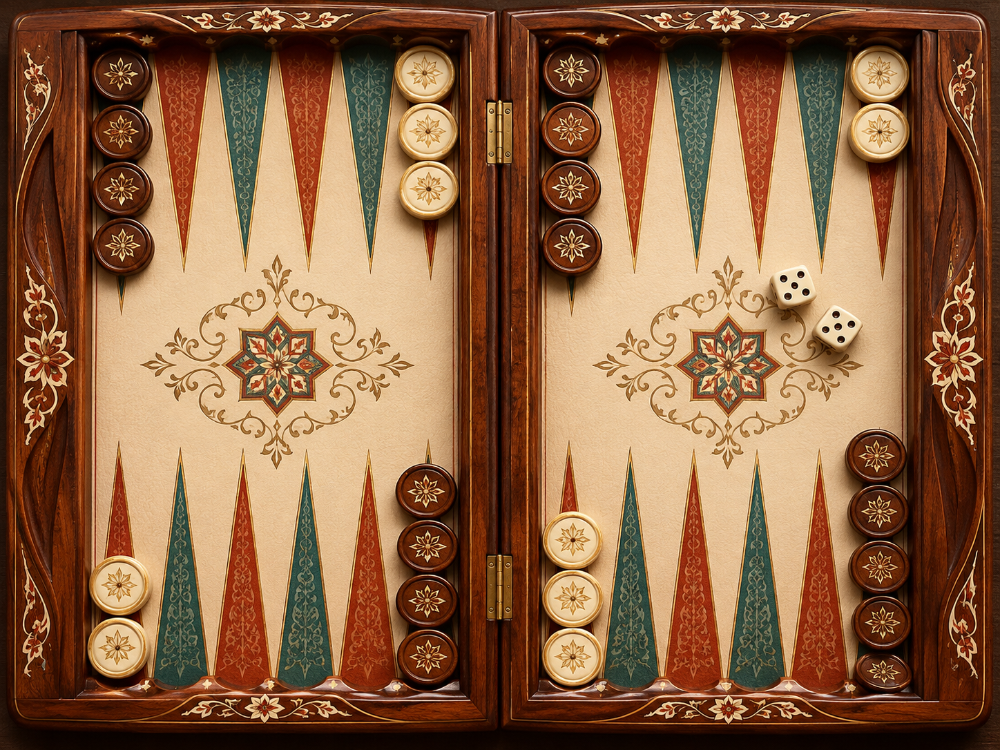

# Qərarlar və fərziyyələr

Məhsul qərarları üçün [GDD](../NARD_Final_GDD_v1.0.md), ardıcıllıq üçün
[Master Plan](../NARD_Master_Icra_Plani_v2.md) əsasdır. Bunların məzmunu dəyişdirilməyib.
Hər yeni qeyd: ID, tarix, növ, əsas, nəticə, təsir və təsdiq vəziyyəti daşımalıdır.

| ID / tarix | Növ və əsas | Qərar / nəticə |
|---|---|---|
| D001 / 2026-11-03 | İstifadəçinin P00.2 göstərişi | Agentdən/modeldən asılı olmayan repo. GDD-də Antigravity sahiblik/prioritet qeydləri məcburi alət tələbi yaratmır. Məhsul qərarları dəyişmir. |
| D002 / 2026-11-03 | İstifadəçinin açıq qadağası | Bütün Skill-lər, Antigravity MCP, Codex Gravity MCP və Antigravity ilə əlaqəli MCP-lər qadağandır. Adi Git/terminal/redaktə icazəlidir. |
| D003 / 2026-11-03 | İstifadəçinin status tələbi | Master Plandakı WAITING_FOR_HUMAN_REVIEW bu repoda AWAITING_HUMAN_APPROVAL kimi saxlanır; mənası eyni gözləmə qapısıdır. SELF_TEST_PASSED insan təsdiqi deyil. |
| D004 / 2026-11-03 | P00.2 daxilində sənəd quruluşu | Orijinal iki mənbənin adı və baytları qorunur. GDD.md / MASTER_PLAN.md surətləri yaradılmır; README dəqiq yol xəritəsidir. |
| D005 / 2026-11-03 | İstifadəçinin bu çatdakı açıq mesajı | P00.1 insan tərəfindən qəbul edilib; yalnız P00.2 icazəlidir. P00.3-ə icazə yoxdur. |
| D006 / 2026-11-03 | İstifadəçinin cavabı | Commit müəllifi Ulvi; təqdim edilmiş e-poçt lokal Git config-də və commit müəllif metadatasındadır. Uzaq ünvan https://github.com/uahadov/nerd.git. Görünüş və push nəticəsi STATE və hesabatda faktiki qeyd olunur. |
| D007 / 2026-11-03 | Agentin P00.2 struktur seçimi; insan baxışına təqdim edilir | ARCHITECTURE modul sərhədlərini sənədləşdirir. Nə yeni xidmət, nə oyun kodu, nə əvvəlcədən Unity/SDK quraşdırması əlavə edilir. |

## Təsdiqlənməmiş / gələcəkdə ölçüləcək

- GDD-də 30/90 saniyə, beta/KPI və 60 FPS rəqəmləri hədəf/fərziyyədir.
- Uzun nərdin yerli variantları P01.1 və beta qapısında doğrulanacaq; RuleSetVersion tələb olunur.
- P00.1-də tapılan Unity versiyası bu partda layihə versiyası kimi sabitlənmir.
- Android alətləri çatışmır; bu partda quraşdırılmır. iOS build/device sınağı aparılmayıb.
- 1 GB VPS uyğunluğu ölçülməyib. İstehsal CockroachDB seçimi saxlanır;
  lokal PostgreSQL yolu yalnız gələcək rəsmi uyğunluq yoxlaması ilə development üçündür.

## D008 — 2026-11-03, uzaq repository

Git ls-remote oxuması uğurludur və 0 ref göstərir. GitHub açıq metadata cavabı
private=false, visibility=public göstərdi. İstifadəçi “davam et sonrada private edərəm”
bildirdi. Bu, lokal P00.2-nin davamı kimi tətbiq edildi; public remote-ə push edilmədi.
Private uzaq nüsxə açıq məsələdir və P00.2-nin tam qəbulundan əvvəl ayrıca həll edilməlidir.

## D009 — 2026-11-03, yalnız P00.2 yekun auditi

Əsas: istifadəçinin açıq mesajı — “İndi yalnız P00.2-nin yekun auditini apar.”
Status AWAITING_HUMAN_APPROVAL qalır; P00.2 qəbulu və P00.3 icazəsi verilməyib.
İstifadəçi mövcud GitHub repository-sinə push etməyi qadağan edib; gələcəkdə yalnız
private repository istifadə ediləcək. Əvvəlki “sonra private edərəm” qeydi avtomatik
push icazəsi deyil. Yekun audit dəqiqləşdirmələri məhsul qərarlarını dəyişmir.

## D010 — 2026-11-03, P00.2 qəbulu və yalnız P00.3 icazəsi

İstifadəçi: “P00.2 mərhələsini təsdiqləyirəm. İndi yalnız P00.3 mərhələsinə keç.”
Unity 6000.6.7f1 istifadə olunur; rəsmi pulsuz Android alətləri quraşdırılması
və real minimal layihə/build/test icazəlidir. Oyun funksiyaları və UI/UX ekranları yoxdur.
P00.2 qəbulu açıqdır; private uzaq nüsxə açıq məsələ olaraq qalır. D008-dəki qəbuldan
əvvəl private backup gözləntisi son insan qərarı ilə təxirə salınıb; push icazəsi verilmir.
Status sonda AWAITING_HUMAN_APPROVAL qalır. Master Planda P00.3-dən sonra P01.1 gəlir;
P00.4 yoxdur və heç bir sonrakı part icazəli deyil. GitHub push qadağası qüvvədədir.

## D011 — 2026-11-03, P00.3 texniki konfiqurasiya

Unity 6000.6.7f1, Test Framework 1.8.0 və Input System 1.20.1 sabitlənir.
Rəsmi Editor-un createProject yolu ilə lokal layihə yaradılır; Unity Cloud/GitHub əlaqəsi qurulmur.
Minimal built-in 2D ortoqrafik kamera və krem fon texniki smoke səhnəsidir; art/UI məhsul qərarı deyil.
Android development APK üçün ARM64/IL2CPP, min API26 (Editor default minimum), target API36 seçilir;
bunlar ilkin sınaq konfiqurasiyasıdır, final cihaz matrisi deyil. Android alətləri rəsmi
Unity CLI-nin bu Editor versiyası üçün seçdiyi modullardır; qlobal sistem JDK/SDK parametrləri dəyişdirilmir.

## D012 — 2026-11-03, Editor vizual yoxlaması və lokal ehtiyatlar

İlk GUI preview köməkçisi PlayMode domain reload zamanı callback-i itirirdi;
SessionState vasitəsilə yalnız açıq preview sorğusunun davamı saxlanıldı.
Təkrar açılış əvvəlki proses bağlanmadan başladığı üçün duplicate-project dialoqu yarandı.
Yalnız agentin bu layihə üçün başlatdığı proseslər bağlandı, köhnə yaradılmış Temp lock
build/P00.3 daxilinə qorunaraq köçürüldü. Heç bir mənbə və Git tarixçəsi silinmədi.
Unity recovery dialoqu üçün istifadəçiyə Keep Backups tövsiyə edildi; _Recovery ehtiyatları
lokal saxlanır və Git-ə daxil edilmir. GUI ilk açılışında Unity SearchDatabase daxilində
ArgumentOutOfRangeException qeydə alındı; yekun retry nəticəsi part hesabatında ayrılır.

## D013 — 2026-11-03, GUI retry nəticəsi

Rəsmi UnityCsReference SearchDatabase.SetupDefaultIndexFirstUse mənbəsində PlayMode-a
keçid vaxtı ilkin index qurulmasının buraxıldığı görüldü. Eyni anda UserSettings/Search.index
yox idi və erkən avtomatik Play tələbi verilirdi. Preview başlanğıcı Editor ilkin
yeniləmələri bitəndən sonraya gecikdirildi; normal Editor API ilə bağlanıb təmiz açıldı.
Son açılışda 25 kadrdan sonra yeni screenshot alındı, C# error və exception sayı 0 oldu.
Bu, müşahidə ilə yoxlanmış lokal həll yoludur; Garuda/Intel üçün ümumi rəsmi dəstək iddiası deyil.
Mənbə: https://github.com/Unity-Technologies/UnityCsReference/blob/master/Modules/QuickSearch/Editor/Indexing/SearchDatabase.cs

## D014 — 2026-11-03, P00.3 qəbulu və yalnız P01.1

İstifadəçi P00.3-ü və Editor-da krem Game ekranını qəbul edib. Fiziki Android testi
aparılmayıb və açıq NOT_RUN qalır. Yalnız Master Plan P01.1 sənəd/test ssenariləri
icazəlidir; “qaydaları hazırla” bu dar əhatədə tətbiq edilir. Qayda motoru P01.2/P01.3
işidir və başlanmır. Status AWAITING_HUMAN_APPROVAL, P01.2 icazəsi false qalır.

## D015 — P01.1 qayda müqaviləsi və açıq variant qapısı

board-global-v1 texniki koordinat müqaviləsi və versiyalı uzun/qısa fixture məlumatı əlavə edildi.
GDD seçimi dəyişmir. L-OPEN/L-HEAD-FIRST və yerli konkretliyi açıq L-BLOCK/L-BEAR/L-HIGH/L-MARS
PROVISIONAL_RULE olaraq qalır; 67 nümunənin ACCEPT/REJECT cavabları motor icrasının nəticəsi deyil.
Tam məlumat rules/fixtures.json-da, insan indeksi RULE_MATRIX.md-dədir; iki müstəqil qərar mənbəyi deyil.
Yerli təcrübəli oyunçu ilə 5 əsas mövqe yoxlanışı PENDING; fərq çıxarsa yeni RulesetVersion lazımdır.

## D016 — 2026-11-03, P01.1 qəbulu və yalnız P01.2

İstifadəçi P01.1-i və altı provisional qaydanın mövcud variantını ilkin standart kimi qəbul etdi.
Azərbaycan üzrə müstəqil yerli oyunçu yoxlaması aparılmayıb; PROVISIONAL_RULE silinmir.
Yalnız Master P01.2 uzun mühərrik icazəlidir. Qısa mühərrik P01.3, seriya və tam match
state machine P01.4-də qalır. İstifadəçinin mars/son vəziyyət tələbi uzun mövqenin nəticə
sorğusu ilə yoxlanır; reytinq/mükafat/seriya sistemi yaradılmır. Push qadağandır.

## D017 — P01.2 texniki müqavilə və açıq dəqiqləşdirmə

LongPosition giriş və çıxış massivlərini kopyalayır; LongNardeRules Unity/RNG/saatdan asılı deyil.
Tam növbə maksimum istifadə və yüksək zər şərtindən keçir. Lokal tək addım analizi yalnız
fixture/preview hesabıdır, tam növbənin qanuniliyi kimi təqdim edilmir.
Eyni qiymətli qoşa tokenlərinin sırf nömrə permutasiyası fərqli oyun seçimi deyil;
generator ən kiçik boş tokeni seçir, validator digər unikal token sıralarını da qəbul edir.
Altılıq üçün artıq çıxarılmış rəqib daşı yolu bitirmiş, yəni blokdan irəli keçmiş sayılır
(koordinat müqaviləsində off=24). Bu sərhəd əvvəlki 67 nümunədə yox idi; ayrıca test əlavə edilir.
Bu şərh də müstəqil yerli oyunçu qapısında açıqdır; qayda versiyası və provisional işarələr saxlanır.
Açıq Editor prosesinə toxunmadan ignored build/P01.2/unity mənbə surətində batch test/build aparılır.

P01.2-də A01-in yalnız qayda mühərriki yazıldığı üçün inventarda status IN_PROGRESS oldu.
A01 məhsul qərarının mətni və ilkin partı dəyişmədi; tam uzun oyun DONE kimi göstərilmir.

## D018 — 2026-11-03, P01.2 qəbulu və yalnız P01.3

İstifadəçi P01.2-ni qəbul etdi və yalnız Master Plan P01.3-ə icazə verdi.
Qısa nərd ayrı immutable mövqe və pure C# assembly-də hazırlanır; uzun kod/testləri qorunur.
Vurma/bar, zər və çıxarma, adi/mars/koks bu partdadır; seriya/match state machine P01.4-də qalır.
Altı uzun provisional variant və müstəqil yerli yoxlama açıq qalır. Fiziki Android NOT_RUN.
Heç bir Skill, qadağan olunmuş MCP, yeni UI/bot/backend yoxdur; GitHub push qadağandır.

## D019 — P01.3 texniki müqavilə və sübut uçotu

Qısa modul ayrı ShortPosition/ShortNardeRules və assembly-dir; uzun kod/testləri SHA-256 ilə qorunur.
Ortaq generik mühərrik refactor-u edilmir. Test/build runner-in mövcud p012.py girişinə --part P01.3
əlavə edilir; eyni skript surətlənmir və əvvəlki CLI default-u saxlanır.
LongRulesTests dəyişmədiyi üçün oradakı 41 tarixi skip qalır. Onların 30-u yeni ShortFixture adı ilə
qısa assembly-də işlənir: 56 unikal fixture icra edilir, 4 undo və 7 seriya/reytinq öz partını gözləyir.
A02 statusu IN_PROGRESS olur; A01 statusu və 87/20 qərar mətni qorunur. Tam oynanıla bilən qısa UI yoxdur.

## D020 — 2026-11-03, P01.3 qəbulu və yalnız P01.4

İstifadəçi P01.3-ü qəbul edib, yalnız P01.4-ə icazə verib. Mənbə: Master P01.4.
Match state machine, nəticə növü/xalı, 1/BO3/BO5, RuleSetVersion və reytinq eligibility-si pure C# modulda qurulur.
İki mühərrik və testləri bayt səviyyəsində qorunur. 7 seriya/reytinq fixture bu partda, 4 undo fixture P02.4-də qalır.
UI/animasiya/bot/backend və P02 yoxdur. Fiziki Android və müstəqil yerli yoxlama NOT_RUN, push qadağandır.

## D021 — P01.4 matç və seriya sərhədi

MatchSession ayrıca Nard.Match assembly-sində iki mühərriki birləşdirir; qaydalar refactor edilmir.
Created→Rolling başlanğıc yarışı; uzun yeni roll gözləyir, qısa ilkin iki qiymətlə Moving olur.
Tam və qanuni TryCommitTurn uğurlu olarsa TurnCommitted, qalib varsa Finished olur.
AdvanceTurn yalnız təsdiqli, bitməmiş növbəni Rolling/sonrakı oyunçuya keçirir. Zər input-dur, RNG yoxdur.
Bu commit lokal domen təsdiqidir; şəbəkə/server qəbulunun sübutu deyil. Online authority gələcək partdadır.
GameResult yalnız bitmiş mühərrik vəziyyətindən yaranır; WinKind və Points ayrıdır.
MatchSeries 1/3/5 partiya limitidir, mars/koks bir qələbədir; GamePoints statistikası kosmetik balans deyil.
Təkrar GameId və uyğun olmayan mode/version rədd edilir. RatingPolicy yalnız ranked random + trusted confirmation
predikatıdır; backend autentifikasiyası və həqiqi reytinq yazılması həyata keçirilmir.
A18 IN_PROGRESS oldu; nə oyun UI-si, nə avtomatik revanş/seriya ekranı DONE kimi göstərilir.
Undo/preview idarəsi P02.4-dədir. 4 undo fixture NOT_RUN qalır; digər 63 fixture müvafiq modullarda icra olunur.

## D022 — 2026-11-03, P01.4 qəbulu və yalnız P02.1

İstifadəçi P01.4-ü hesabat əsasında qəbul edib, yalnız P02.1-ə açıq icazə verib.
Master P02.1: sadə 24 xana, 15+15 daş, iki rəng, zər yerləri, state-ə bağlı görünüş.
P02.2 toxunma/gediş, P02.3 atış/növbə, P02.4 undo və P02.5 iki responsive layout açılmır.
Müvəqqəti qrafika xəbərdarlığı göstərilir; çayxana fonu/avatarlar əlavə edilmir.
Mühərrik/matç kodu və köhnə C# testləri qorunur. Fiziki Android və yerli yoxlama NOT_RUN qalır.

## D023 — P02.1 read-only presentation və texniki layout

Presentation/BoardSnapshot yalnız qəbul edilmiş LongPosition/ShortPosition/MatchSession-dan
counts köçürür. BoardGeometry board-global-v1 indekslərini ekrana yerləşdirir, qayda hesablamır.
BoardView SpriteRenderer/TextMesh ilə öz yaradılmış sadə həndəsi qrafikanı göstərir; əlavə paket yoxdur.
15 daş üst-üstə gizlədilmir, stack diametri mövcud sahəyə uyğun azaldılır; bar/off ayrıca zonadır.
Zərlər hələ atılmır: iki boş yer göstərilir; UI-da bu məhdudiyyət yazılır.
Bir sabit portret texniki kompozisiya aspektə görə letterbox olunur; P02.5 məhsul layout-u deyil.
TechnicalBoard ayrıca səhnədir. Bootstrap və əvvəlki EditorBuildSettings qorunur; P02.1 Android
build açıq scene siyahısı ilə TechnicalBoard-dan başlayır, Bootstrap da regressiya üçün daxil edilir.
Legacy TextMesh-in linear rəng çevrilməsi real screenshot-da solğunluğu aradan qaldırmaq üçün düzəldildi.
Rejim seçimi səhifəsi və gameplay idarəsi yoxdur; qısa/bar-off snapshot-ları test/preview vasitəsilə yoxlanır.

## D024 — 2026-11-03, insanın seçdiyi əsas vizual referans (yalnız sənədləşmə)

Əsas: istifadəçinin son açıq göstərişi — “İlk göndərdiyim nərd dizaynını əsas vizual
referans kimi qəbul et.” Bu qeydə aid əsas şəkil həmin mesajdakı əlavədir;
sonradan agentin generasiya etdiyi digər şəkil əsas referansı əvəz etmir.

- İstiqamət: isti, səmimi, detallı, premium, Azərbaycan ruhunda və real oyun hissi.
  Təbii qoz ağacı, isti krem səth, terrakota/firuzə tonları, fil sümüyü və qoz rəngli daşlar;
  əl işi oyma/inlay, ölçülü milli motivlər və toxunulası material hissi qorunsun.
- Oyuncaq/plastik görünüş olmasın. Gələcək art 2D qalır; şəkil ayrıca 3D/perspektiv sistemi
  qurmaq göstərişi deyil. Xırda ornament, parıltı və kölgələr mobil oxunaqlılığa görə yoxlanmalıdır.
- Final taxta asseti **üfüqi** kompozisiyada hazırlanacaq. **Şaquli matç rejimi saxlanır**;
  horizontal taxta asseti portrait ekran dəstəyini ləğv etmir. Yerləşim P02.5-də ayrıca icazə ilə,
  final vizual istiqamət P04.1 və taxta istehsalı P04.2-də ayrıca icazə ilə işlənəcək.
- Bu şəkil **üslub referansıdır**: təsvir edilmiş daş sayı, düzülüş, zər qiyməti və perspektiv
  qayda müqaviləsi deyil. Final 24 xana/4×6, 15+15 daş, düzgün bar və engine-state uyğunluğu
  mövcud GDD/qayda müqaviləsinə əsaslanacaq; daş/zər qatları gameplay-dən ayrı qalacaq.
- İndi dizayn kodlaşdırılmır, Unity-yə import edilmir, mövcud texniki taxta dəyişmir.
  Bu mesaj P02.1 qəbulu və ya P02.2/P04 başlanma icazəsi deyil.
  Aktiv part P02.1, status AWAITING_HUMAN_APPROVAL, növbəti part icazəsi false qalır.
- Mənbə: istifadəçinin bu mesajda təqdim etdiyi PNG; orijinal baytlar dəyişdirilmədən saxlanıb.
  SHA-256: `ac2b6c31cd386a2c3b49a5b27cc6db6c66be5e7c1ce3d128fb93143efb2f40c3`. Ölçü: 3,284,243 bayt.
  Müəllif/lisenziya müstəqil yoxlanmayıb: yalnız daxili referans, hazır kommersiya asseti deyil.
  Məhsula birbaşa daxil etmə hüququ təsdiqlənmiş sayılmır.
- Repo ölçü qaydasında yalnız bu dəqiq fayl/yol/SHA üçün baxılmış istisna var (4 MiB həddi);
  başqa böyük fayllara və dəyişmiş baytlara ümumi icazə vermir. Master Plan/GDD dəyişmir.

## D025 — 2026-11-03, P02.1 qəbulu və yalnız P02.2

İstifadəçi: “P02.1 mərhələsini təsdiqləyirəm. İndi yalnız P02.2-yə keç.”
Əhatə Master P02.2-dir: daş seçimi, mümkün gediş markerləri, tap gedişi və yanlış seçimə qısa feedback.
Rules/Match və bütün əvvəlki C# testləri qorunur. D024 əsas final vizual referans olaraq qalır;
final art indi kodlaşdırılmır. P02.3 atış/tam növbə, drag/undo, animasiya və online yoxdur.
Native Editor qəzası həll sübutu olmadan açıq riskdir. Fiziki Android/yerli yoxlama NOT_RUN saxlanır.

## D026 — P02.2 tap preview sərhədi və təkrar sınaq nümunəsi

Interaction/TapSelection pure C# application qatıdır, qayda mühərriki deyil. Mövcud LegalTurns-un
maksimum/yüksək zərdən keçmiş tam yollarının yalnız prefiksləri seçilə bilər. Hədəfə toxunanda
həmin yoldakı növbəti addım mövcud TryApplyLocalStep ilə tətbiq edilir; məsafə/baş/bar/blok/xal
qaydaları UI-da təkrar yazılmır. Eyni hədəfə iki zər çıxarırsa, engine-in sabit qanuni tokeni seçilir.
Nəticə lokal, commit edilməmiş preview-dur; MatchSession commit/AdvanceTurn çağırılmır.

BoardHitMap koordinatı, BoardTapInput isə input/feedback-i idarə edir; BoardView yalnız çəkir.
Seçilmiş mənbəyə təkrar tap seçimi söndürür. İşarəli hədəfə tap bir daş aparır. İşarəli hədəf
olmayan başqa qanuni öz mənbəsinə tap seçimi dəyişir; qanunsuz seçim əvvəlki vəziyyəti saxlayır.
Bir native frame/press ID təkrar işlənmir; drag və əlavə barmaq gediş yaratmır.

TapBoard ayrı texniki scene-dir. Əvvəlcədən verilmiş uzun 3–3 nümunəsi açılır; RNG/atış düyməsi,
yeni növbə və rəqib oyunu yoxdur. Dörd hüquq bitəndə aydın bildirilir. “Texniki nümunəni sıfırla”
yalnız test state-ini təzədən qurur ki, insan 5+ tap sınağını edə bilsin; undo/revanş və növbə sistemi deyil.
Bar/vurma/off və digər zərlər qısa/uzun test state-ləri ilə yoxlanır; rejim seçimi ekranı qurulmur.
Növbəsonu flag/owner/commit və zər istehlakının məhsul UI-si P02.3-də qalır.

Avtomatik PlayMode/GUI giriş sınaqları real Unity Input System-ə sintetik Mouse/TouchState hadisələri
verir; bu fiziki barmaq/telefon testi deyil. Yalnız həmin test/preview prosesində müvəqqəti
InputSettings klonu ilə focus routing qurulur, sonra əvvəlki konfiqurasiya klondan bərpa edilir.
Paketin InputManager.settings setter-i HideAndDontSave default-u əvəzləyərkən sildiyi üçün
bərpa obyekti ayrıca kopyalanır. Layihə/sistem ayarları və istifadəçinin giriş konfiqurasiyası dəyişmir.
A50 yalnız texniki marker implementasiyası olaraq IN_PROGRESS olur; məhsul qərarları dəyişmir.

## D027 — 2026-11-03, P02.2 qəbulu və yalnız P02.3

İstifadəçi P02.2-ni hesabat əsasında qəbul edib və yalnız P02.3-ə icazə verib.
Master P02.3: iki zər/state uyğunluğu, növbə başlanğıcı/sonu, token istehlakı, qoşa və avtomatik növbə.
Rules/Match/TapSelection və əvvəlki C# testləri qorunur. D024 premium referansı dəyişmir;
final art və P02.4 drag/undo/sürətli gediş, bot, online və əlavə layout yoxdur.
Fiziki Android/yerli oyunçu NOT_RUN və native Editor qəzası açıq risk olaraq qalır.

## D028 — P02.3 lokal zər mənbəyi və tam növbə tətbiqi

LocalTurnLoop mövcud MatchSession və TapSelection-ı birləşdirir. Created→Begin ilkin atışı gözləyir;
bərabər atışda müqayisə təkrar edilir. Uzunda böyük atan təzə iki zər atır; qısada müqayisə zərləri oynanır.
Yalnız növbə sahibi Rolling-də atış edə bilər. Zərlər injection ilə IDiceSource-dan gəlir;
LocalDiceSource rəsmi .NET RandomNumberGenerator.GetInt32(1,7) istifadə edir. Qayda/Match/render qatında RNG yoxdur.
Bu yalnız lokal iki insanın eyni cihazda sınağıdır; ranked/online zər və təsdiq səlahiyyəti deyil.
Online mənbə gələcək server partında ayrıca qurulacaq; burada server və ya bot yoxdur.

Son qanuni prefiks addımından sonra kök MatchSession.TryCommitTurn bütün təklifi yenidən yoxlayır.
Bitməmiş partiyada AdvanceTurn bir dəfə çağırılır, növbəti oyunçu atış gözləyir. Qanuni yol boşdursa
boş təklif təsdiqlənir və daş dəyişmədən növbə keçir. Bitmiş partiyada yeni atış/növbə açılmır.
Son lokal commit geri çevrilmir; P02.4 undo bu partda hazırlanmayıb. Series/revanş/nəticə səhifəsi yoxdur.

Hər token Available/Used/Unavailable olaraq ayrılır. Normal atışda 2, qoşada 4 token var.
Oynanıla bilməyən qalıq token Used kimi göstərilmir; işlənmiş token xətt, mümkün olmayan token X ilə işarələnir.
İki zərin pipləri yalnız qəbul edilmiş qiymətlərdən çəkilir; render yeni qiymət almır. İlkin bərabər qoşa
oyun üçün 4 hüquq yaratmır. Mənbə səhvi/etibarsız qiymət yarım atış və match dəyişikliyi yaratmır;
xəta zamanı mənbənin daxili oxuma mövqeyinin geri qaytarılması vəd edilmir.

TurnBoard ayrıca texniki scene-dir. Roll düyməsi və piplər sadə 2D-dir; effektli animasiya yoxdur.
İki tərəf əl ilə oynanır. Editor üçün uzun/qısa açılma menyuları test rahatlığıdır, məhsul rejim seçimi ekranı deyil.
P02.2 sabit nümunəsi ayrıca saxlanır; canlı dövrdə onun texniki reset düyməsi yoxdur.

## D029 — 2026-11-04, P02.3 qəbulu, yalnız P02.4 icazəsi

İstifadəçinin açıq mesajı P02.3-ü qəbul edir və yalnız P02.4-ə icazə verir.
Drag, uyğun sürətli toxunma, səhv dragın qaytarılması və commit-dən əvvəl undo icazəlidir.
AWAITING_HUMAN_APPROVAL saxlanır. P02.5, push və final art icazəli deyil.

## D030 — 2026-11-04, lokal undo sərhədi

P02.3 avtomatik commit davranışı qorunur: son qanuni hüquq istifadə edilən kimi növbə bitir.
Undo yalnız cari oyunçunun hələ açıq növbəsində son yerli addımı geri alır; təkrar undo addım-addımdır.
İlkin immutable mövqedən qanuni prefiks təkrar qurulur; bar/off, baş hüququ və zər maskası da bərpa olur.
UI qaydanı hesablamır. Sürətli gediş yalnız seçilmiş daşın bir unikal qanuni hədəfi olduqda təkrar qısa toxunuşdur.
Bir neçə hədəf varsa oyunçu hədəfi özü seçir. Bu, yeni məhsul qaydası deyil, P02.4 minimal tətbiqidir.

## D031 — 2026-11-04, insanın cari görünüş dəyişikliyinə açıq icazəsi

İstifadəçi yeni şəkillə “İndi yenidən deyirəm nərdin görünüşünü attığım görünüş et” bildirdi.
Əvvəlki “sonra tətbiq et / final art-a keçmə” məhdudiyyətini bu konkret taxta görünüşü üçün yeniləyir.
P02.4 aktiv qalır: onun işi və testləri tamamlanır, taxta/daşların referans üslubu indi tətbiq olunur.
Bu, P02.5 və ya P04-ün bütövlükdə başlanması/tamamlanması deyil. Digər ekran, məkan və motion yoxdur.
Orijinal referans D024-də qorunur. Ondan AI vasitəsilə boş taxta və ayrıca şəffaf daş atlası hazırlanır;
daş/zər vəziyyəti şəkilə yapışdırılmır. Qayda, zər və input niyyəti həmin mühərriklərdən gəlir.
Yeni art daxili sınaq üçündür; orijinal referansın kommersiya hüququ müstəqil təsdiqlənməyib.
