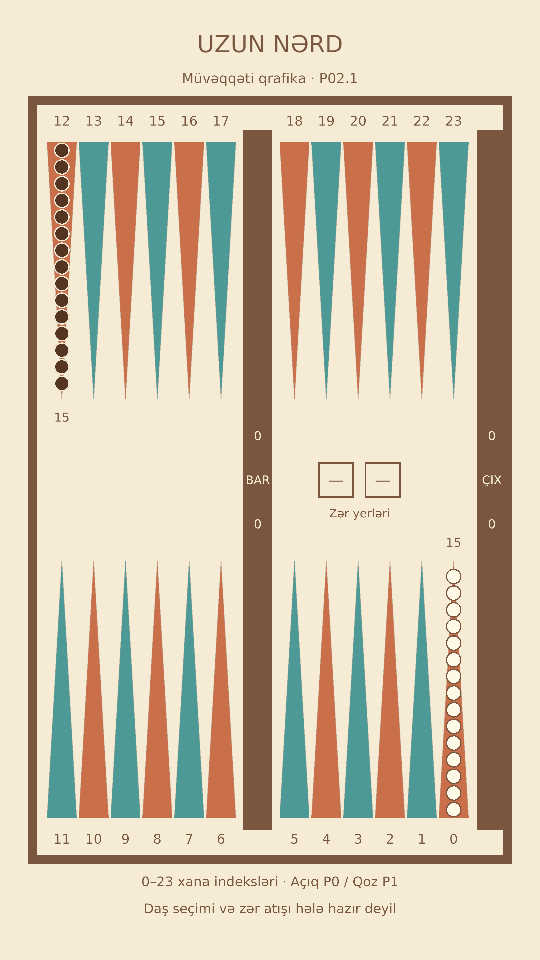
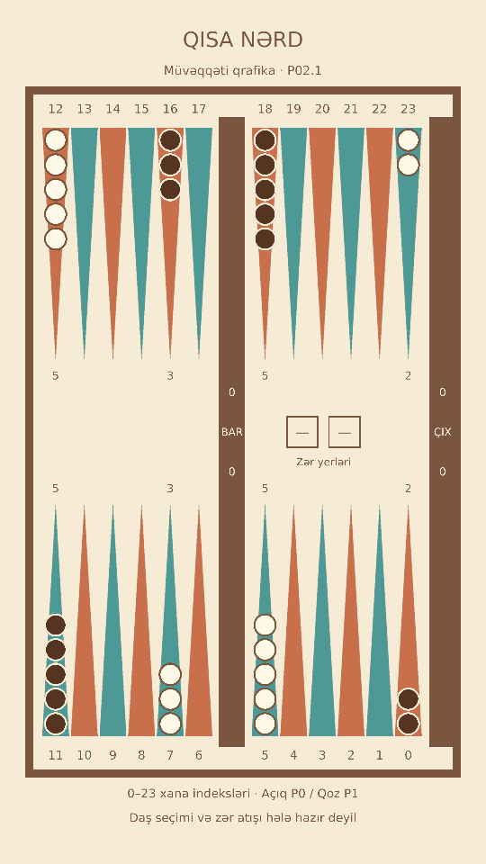
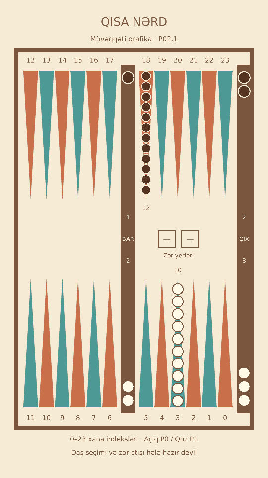
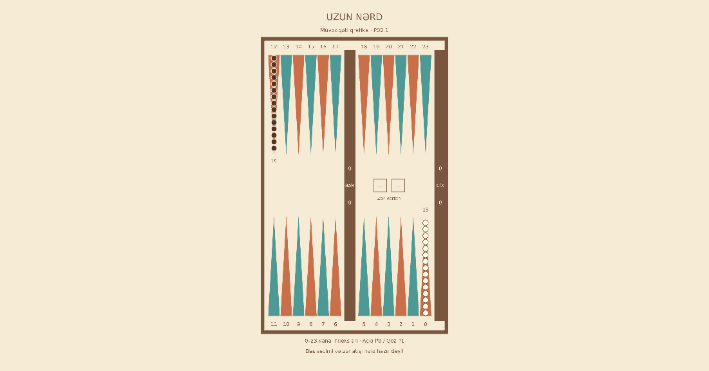

# P02.1 — texniki nərd taxtası

Status: **AWAITING_HUMAN_APPROVAL**. Tarix: 2026-11-03, Asia/Baku.
İcazə: istifadəçi P01.4-ü hesabat əsasında qəbul edib, yalnız P02.1-ə keçməyi tapşırıb.
Əsas: Master Plan P02.1, GDD §4/§7/§10, [D022–D023](../DECISIONS.md).

## İcra və sərhəd

Ayrıca TechnicalBoard scene-də sadə, oxunaqlı 2D taxta quruldu: global 0..23 indeksli 24 xana,
15 açıq P0 və 15 qoz rəngli P1 daşı, bar/çıxış zonaları, iki boş zər yeri.
Hər daş qəbul edilmiş engine state-indəki saydan yaranır. Bir xanada 15 daş olanda diametr
kiçilir, bütün daşlar ayrıca görünür; say da ayrıca yazılır. Bar/off 24 xananın hissəsi deyil.

Müvəqqəti qrafika olduğu və daş seçimi/zər atışının hazır olmadığı ekranda açıq göstərilir.
Uzun/qısa rejim seçimi ekranı yaradılmayıb. Android ilkin uzun vəziyyətlə açılır; qısa və bar/off
vəziyyətləri Editor test/preview vasitəsilə çəkilib. Bu part hələ oynanıla bilən tam matç deyil.
P02.2 seçim/gediş, P02.3 zər/növbə, P02.4 undo və P02.5 iki responsive layout hazırlanmayıb.
Bir sabit portret kompozisiya ekran nisbətinə letterbox olunur; mobil orientation qəbulu iddia edilmir.
Çayxana fonu, avatar, animasiya, bot, multiplayer və əlavə böyük asılılıq yoxdur.

## Fayllar

- Presentation/BoardSnapshot.cs: mövcud LongPosition/ShortPosition/MatchSession üçün read-only projection.
- Presentation/BoardGeometry.cs: yalnız global indeks → vizual yer və stack yerləşimi.
- Presentation/BoardView.cs + Nard.Presentation.asmdef: prosedur sprite/TextMesh görünüşü.
- Scenes/TechnicalBoard.unity: ayrıca texniki səhnə.
- Editor/P021Build.cs və P021Preview.cs: açıq lokal build/Editor preview əmrləri.
- Tests/BoardEditor və Tests/BoardPlayMode: yeni projection və scene/render testləri.
- Mövcud runner/validator, onun testləri, status və aidiyyəti sənədlər yeniləndi.

Bütün yeni Unity fayllarının .meta sidecar-ları var. Qayda mühərrikləri və matç sistemi
UI-dan asılı deyil; presentation qayda hesablamır, engine state-i dəyişmir. Əvvəlki C# testləri dəyişməyib.
Bootstrap scene və EditorBuildSettings qorunub. APK explicit scene siyahısı ilə TechnicalBoard-dan
başlayır; köhnə Bootstrap da build-ə daxil edilir. Editor menyusu yeni scene-i rahat açır.

## Testlər və sübut

Yekun icra nəticələri aşağıdakı fayllarda saxlanır:
[EditMode XML](P02.1.editmode.xml), [PlayMode XML](P02.1.playmode.xml),
[icra və 67 nümunənin ledger-i](P02.1.execution.json), [Python logu](P02.1.tests.txt),
[struktur yoxlaması](P02.1.validation.json).

38 yeni EditMode testi: 24 unikal düzgün indeks; hər xananın bütün 15 daşı; heç bir checker face-in
üst-üstə düşməməsi; hər iki oyunçuda 15 bar və 15 off; rejim dəyişməsi/təkrar renderdə köhnə daş
qalmaması; snapshot dəyişməzliyi; null, indeks, say, ordinal sərhədləri və Azərbaycan hərfləri.
Yeni PlayMode testi real scene-i yükləyir, uzun/qısa/bar-off snapshot-larında 30 daş/24 xana,
viewport bounds və real pixel rənglərini yoxlayır. Screenshot CPU ilə təqlid edilməyib.

67 canonical nümunənin 63-ü əvvəlki suite-lərlə yenidən icra olunur: 26 uzun, 30 qısa, 7 seriya/reytinq.
4 undo: L_UNDO_LOCAL, L_UNDO_COMMITTED, S_UNDO_LOCAL, S_UNDO_COMMITTED — **NOT_RUN**, P02.4.
Uzun suite-in 41 tarixi skip-i saxlanır; onların 37-si digər suite-lərdə həqiqətən keçir.
Skip-lər PASS sayılmır. Fiziki Android, iOS və müstəqil yerli oyunçu yoxlaması **NOT_RUN** qalır.
Altı PROVISIONAL_RULE dəyişməyib. Təkrar əmrlər [test matrisindədir](../TEST_MATRIX.md).

## Vizual sübut

Aşağıdakılar real Unity Editor PlayMode camera renderləridir, 540×960 ölçüdədir:

Font və daş konturları real render baxışından sonra düzəldildi. Yeni gameplay klik/touch testi yoxdur;
P02.1-də gameplay input-u yoxdur. Fiziki Android görünüşü bu şəkillərlə təsdiqlənmiş sayılmır.

## Tapılan və düzəldilən problemlər

- Build summary say sahələri Unity API-də int olduğu üçün ilk compile dayandı; doğru tipə düzəldildi.
- Preview helper-in assembly istinadları tamamlandı; yeni testin yanlış EditMode qrupuna düşməsi düzəldildi.
- Legacy TextMesh linear rəng çevrilməsi yazıları solğun göstərirdi; mətn rəngi uyğun çevrildi.
- Bar/off qoz fonunda tünd daşlara açıq kontur əlavə edildi; iki rəng daha aydın ayrılır.

Ayrıca açıq məsələ UNITY-EDITOR-EXIT: əvvəldən açıq əsas Editor bağlanarkən Unity Analytics /
UnityWebRequest native cleanup hissəsində SIGSEGV yaradıb. Səbəb təsdiqlənməyib. Qəza dump-u
və log build/P02.1/diagnostics/ daxilində qorunur, Git-ə daxil edilmir; qlobal sistem/telemetri
parametrləri dəyişdirilməyib. P02.1-in ayrıca GUI preview prosesi exit=0 ilə bağlanıb və bu
qəza orada təkrarlanmayıb. Bu müşahidə avtomatik “həll edildi” sayılmır.
Repository yoxlayıcısı 10 MB native dump-u haqlı olaraq rədd etdi; diaqnostika silinmədən lokal
ignored build yerinə köçürüldü və mono_crash.* qaydası əlavə edildi.
Əlavə xidmət/ödəniş/server müdaxiləsi yoxdur; Skill və qadağan olunmuş MCP işlədilməyib.

## İnsan üçün 5 sadə yoxlama

1. Unity-də **NARD → P02.1 → Open technical board** seçin, sonra Play basın.
   Krem fonda texniki taxta və “Müvəqqəti qrafika · P02.1” yazısı görünməlidir.
2. Aşağı sağdakı 0 xanasında 15 açıq, yuxarı soldakı 12 xanasında 15 tünd daş görünməlidir.
   Heç biri yalnız say nişanı ilə gizlədilməyib; hər daş ayrıca görünür.
3. 0..23 indekslərini, BAR/ÇIX zonalarını və iki boş zər yerini yoxlayın. Daşlara toxunmaq
   onları hərəkət etdirməməlidir; gediş/atışın hələ hazır olmadığı yazılıb.
4. Yuxarıdakı qısa şəkillə standart 2/5/3/5 düzülüşünə, bar/off şəkillə ayrıca zonalara baxın.
   Bunlar test snapshot-larıdır, ayrıca oyun rejimi seçimi səhifəsi deyil.
5. Fiziki telefonunuzda ayrıca yoxlama aparmaq istəsəniz lokal APK-ni açın. Taxtanın zonalarının
   oxunaqlılığını bildirin. Bu insan cihaz yoxlaması aparılanadək **NOT_RUN** qalır.

İnsan baxışı gözlənilir. P02.2 və başqa part üçün açıq icazə yoxdur.

## Yekun real nəticə

| Yoxlama | Nəticə |
|---|---|
| EditMode / compile | **301 PASS**, 0 FAIL, 41 tarixi skip; 263 əvvəlki + 38 yeni |
| PlayMode | **2 PASS**, 0 FAIL; 1 əvvəlki + 1 yeni scene/render |
| Python repository/specification/runner | **100 PASS**, 0 FAIL (referans qeydi auditi ilə) |
| Struktur yoxlaması | **15 PASS**, 0 FAIL |
| Android ARM64 IL2CPP development | **Succeeded**, 0 error, 0 warning, 13.01 saniyə (təkrar, cache ilə) |
| APK imzası | Rəsmi bundled OpenJDK/apksigner.jar verify exit=0 |
| Ayrıca Unity GUI preview | Game View çəkildi, 25 kadr, exit=0 |
| Fiziki Android / iOS / yerli oyunçu | **NOT_RUN** |

APK: build/P02.1/NARD-P02.1.apk, 25,421,110 bayt.
SHA-256: `c471ff734dd5c03dd6cda74aae054b1525f5c7117a4019439022ecfa703e5329`.
Unity summary-dəki 230,205,456 bayt build məzmunudur, sıxılmış APK ölçüsü ayrı göstərilir.
Raw log/XML/APK-lər ignored build/P02.1 daxilindədir; XML və sanitizasiya edilmiş nəticələr Git-dədir.
Geniş GUI Game View-da sabit portret taxta letterbox olunur; bu, landscape məhsul UX testinin PASS-ı deyil.

Yeni runtime/test mənbə hash-ləri bütün test/build addımlarında qeydə alınıb və cari fayllarla
uyğunluğu yoxlanıb. 67 nümunənin fərdi statusu execution JSON-da saxlanır. Heç bir qayda və
əvvəlki C# test faylı dəyişdirilməyib; 87 qəbul/20 rədd mətnləri qorunur.
Lokal Git commit insan təsdiqi deyil; GitHub push edilməyib. P02.1 təsdiq gözləyir.

Git audit: 55 unikal Unity meta GUID və sidecar cütü PASS; git diff --check PASS;
git fsck exit=0 (4 dangling blob + 1 dangling tree, korrupsiya yoxdur, obyektlər silinməyib).
Əvvəlki 263 EditMode və 1 PlayMode PASS testinin tam adları yeni XML-də də PASS olaraq tapılıb.
APK ZIP CRC və ARM64 IL2CPP kitabxanası yoxlanıb. Native dump ignore probe PASS.

## Əlavə — əsas vizual referansın sənədləşməsi

İstifadəçinin son mesajı ilə əsas şəkil orijinal baytları saxlanaraq
[referans qeydinə](../DECISIONS.md) D024 və asset manifestinə əlavə edildi.
Üfüqi final taxta və şaquli matç dəstəyi birlikdə saxlanır. Bu yalnız üslub seçimidir;
P02.1 insan qəbulu, P02.2/P04 başlanğıcı və final asset tətbiqi deyil.
Bu yeniləmədə Unity/qaydalar/səhnə/build dəyişməyib, Unity və Android testləri təkrar icra edilməyib;
yuxarıdakı nəticələr əvvəlki real P02.1 icrasının qorunan sübutlarıdır.
Sənəd yeniləməsindən sonra 15 struktur yoxlaması və 100 Python testi PASS oldu;
iki yeni mənfi test böyük referans üçün yalnız dəqiq yol/hash istisnasını qoruyur.
Aktiv part/status/insan qəbulu qapısı dəyişmir; push edilmir.
