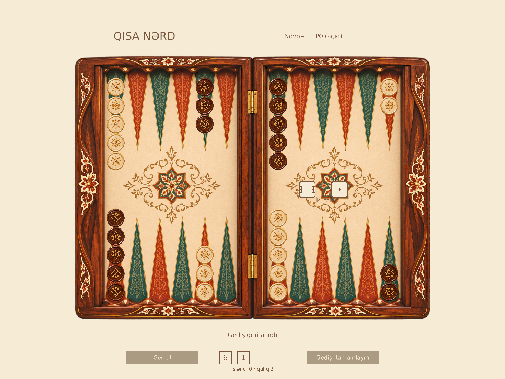

# P02.4 — sürükləmə, sürətli toxunma və Undo

- Status: **AWAITING_HUMAN_APPROVAL**
- Tarix: 2026-11-04 / Asia/Baku
- İcazə: P02.3 insan tərəfindən qəbul edilib, yalnız P02.4 açılıb (D029).
  Son “nərdin görünüşünü attığım görünüş et” göstərişi ilə konkret taxta/daş görünüşü də indi icazəlidir (D031).
- P02.5, bot, online, başqa ekranlar və digər final art mərhələləri açılmayıb. GitHub push yoxdur.

## Hazırlanan davranış

Daş markerə sürüklənir; buraxılana qədər mühərrik vəziyyəti dəyişmir. Səhv xana, ekran xarici
və düymə üzərinə buraxma gediş yaratmır. İkinci barmaq, touch cancel, fokus itkisi və disable sürükləməni ləğv edir.
Kiçik sürüşmə qısa tap sayılır. Seçilmiş daşın yalnız bir qanuni hədəfi varsa ikinci qısa tap həmin gedişi edir;
bir neçə hədəfdə avtomatik seçim yoxdur.

“Geri al” cari açıq növbədə son addımı qaytarır. Təkrar Undo addım-addımdır. Qayda mühərrikinin
qanuni prefiksi dəyişməyən kök mövqedən yenidən qurulur: daşlar, vurulan daş/bar, off, baş hüququ,
ilk növbə flag-ləri və istifadə maskası birlikdə bərpa olunur. Yeni zər yaradılmır.
P02.3 avtomatik commit saxlanır: son qanuni addım növbəni tamamlayır; bundan sonra əvvəlki növbə geri alınmır.
Bu lokal iki insan prototipidir; server/network təsdiqi həyata keçirilməyib.

## Görünüş və fayllar

D024 orijinal referansı dəyişməyib. D031 üzrə qoz çərçivə, krem səth, milli naxışlar,
terrakota/firuzə xanalar və işləməli fil sümüyü/qoz daşları Unity səhnəsinə tətbiq edilib.
Taxta boş şəkildir; daş və zər vəziyyəti şəkilə yapışdırılmayıb. Daşlar sabit ölçüdədir;
uzun stack görünən üst-üstə düşmə və say göstəricisi ilə yığılır. Taxta üfüqidir.
İki responsive ekran P02.5 işidir və bu nəticə onun tamamlanması sayılmır.

- Yeni application: unity/Assets/Game/Interaction/UndoPreview.cs; LocalTurnLoop-da açıq növbə tarixçəsi.
- Input/render: BoardTurnInput.cs, BoardHitMap.cs, BoardView.cs; ayrıca ReferenceBoardSkin.cs render adapteri.
- Assetlər: Presentation/Resources/NardBoard.png (1448×1086), NardCheckers.png (1774×887).
  Mövcud image generation imkanı ilə istifadəçi referansından yaradılıb; xarici paket gətirilməyib.
  Hüquq qeydləri [manifestdə](../ASSET_MANIFEST.csv) daxili preview kimi saxlanır; kommersiya hüququ yoxlanmış iddia edilmir.
- Yeni səhnə: unity/Assets/Game/Scenes/UndoBoard.unity. Köhnə Bootstrap/TechnicalBoard/TapBoard/TurnBoard saxlanır.
- Editor: P024Build.cs, P024Preview.cs; yeni testlər Tests/UndoEditor və Tests/UndoPlay daxilindədir.
- Runner-in P02.4 yoxlaması genişlənib; eyni source copy-yə paralel test/build açılması əvvəlcədən kilidlənir.
- AGENTS, STATE, PROGRESS, DECISIONS, arxitektura, test matrisi, inventar statusları və README yenilənib.
  GDD, Master Plan, 87 qəbul / 20 rədd mətni, Rules/Match/TapSelection/zər mənbəyi və əvvəlki C# testləri qorunur.

## Həqiqi test nəticələri

[İcra sübutu və hər 67 ID-nin statusu](P02.4.execution.json),
[EditMode XML](P02.4.editmode.xml), [PlayMode XML](P02.4.playmode.xml).

| Yoxlama | Faktiki nəticə |
|---|---|
| Unity 6000.6.7f1 import/compile | 0 C# xəta |
| EditMode | **749 PASS, 0 FAIL, 41 tarixi Ignore** |
| PlayMode | **17 PASS, 0 FAIL, 0 skip** |
| Yeni EditMode əhatəsi | 225 test: 144 rejim/actor/roll, 43 mövqe, 4 canonical Undo, əlavə çoxaddımlı/qismən/bitmiş/istisna halları və 27 input xəritəsi |
| Yeni PlayMode əhatəsi | 5 test: mouse drag/undo/quick; uzun/qısa touch; multitouch/cancel/sərhəd/düyməyə buraxma; jitter/çoxhədəfli tap |
| Əvvəlki regressiya | Əvvəlki 524 EditMode və 12 PlayMode PASS adı cari XML-də də PASS-dır |
| Canonical 67 nümunə | **67 PASS, 0 NOT_RUN**: 26 uzun + 30 qısa + 7 matç + 4 Undo |
| Python / struktur | **115 PASS / 0 FAIL; 15/15 struktur PASS** — [Python logu](P02.4.tests.txt), [validator JSON](P02.4.validation.json) |
| Android build | PASS, ARM64 IL2CPP development APK, build errors=0 / warnings=0 |
| APK | CRC və ARM64 kitabxanaları PASS; rəsmi apksigner verify exit=0, **v2 imza PASS**; mağaza release imzası deyil |
| Ayrı native Editor GUI | exit=0; drag → 1 sərf, undo → 0 sərf, yanlış drop → 0, sürətli tap → 1; hər addımın state yoxlaması PASS |
| Fiziki Android | **NOT_RUN** — ADB-də 0 bağlı cihaz; cihaz ID-si saxlanmayıb |
| Müstəqil yerli oyunçu / iOS | **NOT_RUN** |

Dörd əvvəl gözləyən nümunə: **L_UNDO_LOCAL, L_UNDO_COMMITTED, S_UNDO_LOCAL, S_UNDO_COMMITTED**.
Hər biri kanonik JSON-un before və expected.after məlumatı ilə birbaşa yoxlanır.
Uzun test faylındakı 41 köhnə Ignore dəyişməyib; 30-u ShortFixture, 7-si MatchFixture, 4-ü UndoFixture
kimi ayrıca icra edilib. Ignore özlüyündə PASS sayılmır. Server infrastrukturu olmadığı üçün
“COMMITTED” nümunələri lokal təsdiq sərhədini yoxlayır, real server end-to-end testini deyil.

Unity testləri və GUI sürükləməsi Input System-ə sintetik Mouse/TouchState hadisələri verir;
bunlar fiziki barmaq və ya telefon sınağı deyil. Editor renderləri realdır. Əmrlər [test matrisindədir](../TEST_MATRIX.md).

## Vizual sübut

[Uzun drag](../screenshots/P02.4-undo-drag-long.png),
[uzun gediş](../screenshots/P02.4-undo-moved-long.png),
[uzun Undo](../screenshots/P02.4-undo-restored-long.png),
[qısa drag](../screenshots/P02.4-undo-drag-short.png),
[qısa gediş](../screenshots/P02.4-undo-moved-short.png),
[mouse Undo](../screenshots/P02.4-undo-restored.png),
[ayrıca native Editor Game View](../screenshots/P02.4-editor-gameview.png).
PlayMode şəkilləri 1440×1080, native Game View ölçüsü icra JSON-unda qeyd edilir.

## Düzəldilən problemlər və açıq risklər

- Son daşın hələ commit edilməmiş önbaxışını geri alma çatışmazlığı düzəldilib;
  bitmiş matçın nəticəsini geri çevirməmək ayrıca hər iki rejimdə test edilib.
- Drag təsvirinin bir kadr gec silinməsi dərhal deaktivasiya ilə düzəldilib.
- Sürükləmənin düyməyə buraxılaraq Undo/roll işlətməsi bloklanıb; əlavə barmaq və cancel yoxlanıb.
- Paralel runner cəhdi duplicate-project lock verdi; mənbə surətini hazırlamazdan əvvəl exclusive lock və iki mənfi/reliz testi əlavə edilib.
- İlk GUI screenshot sorğusu növbəti input ilə eyni kadrda idi; capture və action ayrılıb,
  hər mərhələyə real state assert əlavə olunub və GUI yenidən icra edilib.

**Köhnə Unity native Analytics/WebRequest cleanup SIGSEGV həll edilməyib.**
Diaqnostika build/P02.1/diagnostics daxilində qalır. Yekun üç batch və ayrıca GUI exit=0 ilə bitib;
bu icralarda təkrarlanmayıb. Səbəb/həll təsdiqlənmədiyinə görə açıq riskdir; kritik sistem parametrləri dəyişdirilməyib.
Altı PROVISIONAL_RULE və müstəqil yerli yoxlama qapısı saxlanır. Telefon rahatlığı/FPS və iOS işləməsi iddia edilmir.

## Build və insan yoxlaması

APK: **build/P02.4/NARD-P02.4.apk** — **38,786,749 bayt**.
SHA-256: `67a4c2d6c1ab9be746f053b41ab061b938507876f58d0674094250f1f423c739`.
Eyni ölçü/hash STATE və icra JSON-unda saxlanır.
Raw log/XML, əlavə GUI şəkilləri və APK ignored build/P02.4-dədir; əsas sübutlar Git-də saxlanır.
Əlavə xidmət, paket, ödəniş, server dəyişikliyi və GitHub push yoxdur. Skill və qadağan olunmuş MCP istifadə edilməyib.

1. Unity-də **NARD → P02.4 → Open undo long match**, sonra **Play** seçin.
   İlk atışı edin; uzunda qalib üçün təzə iki zər atın.
2. Öz daşınızı bal rəngli hədəfə sürükləyin: bir daş köçməli və bir hüquq işlənməlidir.
   Son hüququ bitirmədən **Geri al** seçin: daş və həmin zər hüququ qayıtmalıdır.
3. Daşı bağlı xanaya və ya taxtanın xaricinə sürükləyin: mövqe və hüquqlar dəyişməməlidir.
   Bir hədəfli seçilmiş daşa ikinci qısa toxunma həmin gedişi etməlidir; çox hədəfdə özünüz hədəf seçirsiniz.
4. Bütün qanuni hüquqları oynayın: növbə rəqibə keçməlidir; əvvəlki növbəni **Geri al** ilə qaytarmaq olmaz.
5. Stop edib **NARD → P02.4 → Open undo short match → Play** seçin və eyni yoxlamaları qısada edin.
   Taxta/daş görünüşünə də baxın. Telefon imkanı yarananda APK ilə ayrıca təkrarlayın; hazırda fiziki test NOT_RUN-dır.

96 unikal meta GUID/sidecar yoxlanıb, əvvəlki testlər qorunub. Git fsck exit=0; referanssız obyektlər silinməyib.
Yekun lokal commit ID-si Git tarixçəsində və çat hesabatında göstərilir; push edilmir.
**İnsan təsdiqi gözlənilir. P02.5-ə və başqa parta icazə yoxdur.**
