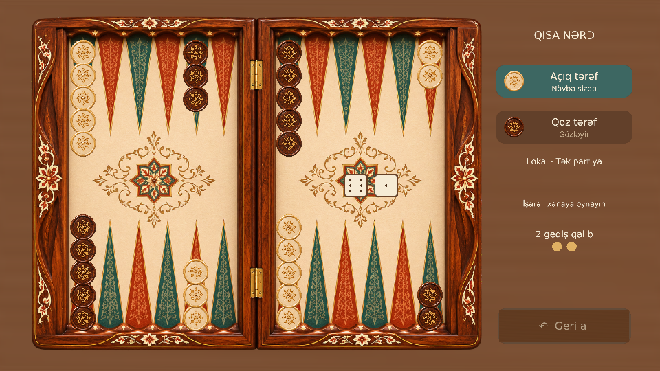

# P02.5 — şaquli və üfüqi matç yerləşimi

- Status: **AWAITING_HUMAN_APPROVAL**
- Tarix: 2026-11-04 / Asia/Baku
- İcazə: D033 P02.5 başlanğıcı; D034 istifadəçinin eyni partda iki orientasiya/HUD düzəlişi brifi.
- P02.4 funksional qəbuldur; əvvəlki səhnə/HUD görünüşünün rəddi D032-də saxlanır.
- Yalnız P02.5 işlənib. P02.6/save, bot, online, başqa ekran və final polish yoxdur.

## Nəticə — D034 düzəlişi

İnsan əvvəlki P02.5 görüntüsünü premium mobil oyun üçün yetərli saymadı; bu iş eyni partın düzəlişidir.
Əvvəl portret taxtanın 90° çevrilmiş görüntüsü idi, daşlar çox kiçik, HUD-da yalnız bir tərəf və izahsız hüquq nöqtələri görünürdü.
İndi portret ayrıca iki dik tray-dən qurulur: əvvəlki sol yarı yuxarıda, sağ yarı aşağıda, hərəsində altı üst/alt xana. Soldan sağa sıra: yuxarı hissə 12–17 / 11–6, aşağı hissə 18–23 / 5–0.
Taxta şəkli bütöv döndərilmir. 24 point ID və hər iki rejimin gediş istiqaməti dəyişmir.
Landşaftda təbii 4:3 taxta saxlanır. Portret tray-ləri üçün çərçivə və üçbucaq sprite-ləri həmin dəyişməyən
asset atlasından ayrılır; dairəvi daşlar və ornamentlər sıxılmır. Portret üçbucaqlarının uzunluğu yeni sahəyə uyğun qurulur.
Üçbucaqdan kənar atlas pikselləri Unity sprite üçbucaq mesh-i ilə kəsilir; yeni xarici asset/asılılıq yoxdur.

Daş diametri landşaftda artırılıb; portretdə 540×960 görüntüdə əvvəlki təxminən 32 pikseldən təxminən 55 pikselə çıxır.
Dəqiq ölçü viewport/safe area-dan asılıdır. Qonşu xanalara keçməyən geniş və uzun toxunma sahələri istifadə edilir;
yalnız kiçik dairəyə dəqiq basmaq tələb olunmur. Seçim halqası, firuzə/bal hədəfi və böyük stack üçün say nişanı var.
HUD hər iki real lokal tərəfi, aktiv növbəni, zərləri, qalan hüquqları, işlənmiş hüquq xəttini və bağlı hüquq × işarəsini göstərir.
Lokal dövrə tək partiyadır: profil adı, reytinq, BO3/BO5 seriya hesabı uydurulmur. Domen seriya modulu qorunur;
onu canlı ekranla birləşdirmək bu partın işi deyil. Oyunsonu qalib etiketi mövcud nəticədən gəlir.
Undo yalnız CanUndo zamanı aktiv görünür, zər idarəsi yalnız CanRoll zamanı görünür. Son hüquq avtomatik commit edir.
Qalın off zolağı yoxdur; bar/off idarəsi və hədəfləri kiçik real sahələrdə saxlanır.

Müqayisə: [əvvəlki landşaft](../screenshots/P02.5-before-landscape.png),
[əvvəlki portret](../screenshots/P02.5-before-portrait.png), yeni görüntülər aşağıdadır.
Bu yerləşim/oxunaqlılıq düzəlişidir; final polish və P02.6 icra edilməyib. Görünüşün insan qəbulu hələ yoxdur.

## Kod sərhədi və fayllar

- MatchBoardLayout.cs: viewport/safe area, iki yerləşim, kanonik input xəritəsinin tərs çevrilməsi.
- MatchHudView.cs: mövcud snapshot/hüquqları göstərən board/HUD renderer; qayda və RNG hesablamır.
- BoardView.cs: yalnız ölçü/safe-area dəyişəndə yenidən yerləşmə; açıq preview ölçüləri üçün test yolu.
- BoardTurnInput.cs: çevrilmə kadrında köhnə koordinatlı drag ləğv edilir, saxta gediş yaranmır.
- ReferenceBoardSkin.cs: mövcud sprite-ləri paylaşan read-only property-lər; əvvəlki statik səhnə saxlanır.
- Yeni səhnə: unity/Assets/Game/Scenes/LayoutBoard.unity.
- Editor alətləri: P025Build.cs və P025Preview.cs; Tests/LayoutEditor və Tests/LayoutPlay testləri.
- Mövcud Rules/Match/Interaction, zər mənbəyi, əvvəlki C# testləri, GDD/Master və 87/20 qərar mətnləri dəyişmir.
- Yeni paket, xarici art xidməti və böyük asılılıq yoxdur. Taxta/daş PNG-ləri təkrar istifadə olunur;
  HUD materialı sadə orijinal kodla yaranır və asset manifestində qeyd edilir.

Screen ölçüsü/safe area runtime-da izlənir. Dönüş zamanı eyni LocalTurnLoop, immutable Session,
zər qiymətləri, istifadə maskası və Undo tarixçəsi saxlanır; yeni matç və ya atış yaradılmır.
Bu RAM-dakı yerləşim yeniləməsidir; tətbiqi bağlayıb bərpa etmək P02.6 işidir.

## Həqiqi test nəticələri

[İcra JSON-u və bütün 67 ID](P02.5.execution.json),
[EditMode XML](P02.5.editmode.xml), [PlayMode XML](P02.5.playmode.xml).

| Yoxlama | Nəticə |
|---|---|
| Unity import/compile | 0 C# xəta |
| EditMode | **779 PASS, 0 FAIL, 41 tarixi Ignore** |
| PlayMode | **24 PASS, 0 FAIL, 0 skip** |
| Yeni yerləşim testləri | 30 EditMode və 7 PlayMode |
| Əvvəlki regressiya | Əvvəlki 749 EditMode/17 PlayMode və ilk P02.5-in 777/22 PASS adları cari XML-də də PASS-dır |
| Qayda nümunələri | **67/67 PASS**; 26 uzun + 30 qısa + 7 matç + 4 Undo |
| Python / struktur | **118 PASS, 0 FAIL; 15/15 struktur PASS** — [Python logu](P02.5.tests.txt), [validator JSON](P02.5.validation.json) |
| Android | ARM64 IL2CPP development APK build PASS; apksigner v2, CRC və kitabxanalar PASS |
| Ayrı native Editor | GUI exit=0; drag/undo/yanlış drop/sürətli tap mərhələlərinin real state assert-ləri PASS |
| Fiziki Android / iOS / yerli oyunçu | **NOT_RUN** |

24 həndəsə kombinasiyası: 12 ölçü, hər birində full və notch safe area.
320×568, 390×844, 540×960, 720×1600, 768×1024, 1024×768, 960×540,
1600×720, 1920×1080, 2340×1080, 1080×2340 və 600×600 ölçüləri yoxlanıb.
Hər ölçüdə 24 xana, iki oyunçunun bar/off sahələri, ayrı idarələr, orientasiyaya uyğun board aspect,
board sahəsinin payı, bütün qonşu toxunma sahələrinin ayrılığı, xana kənarlarından seçim və tərs input xəritəsi yoxlanır. Yanlış ölçü üçün üç exception və safe-area fallback/clipping testi var.

PlayMode-da beş nisbətin real kamera renderi, 30 daşın safe-area sərhədləri və zərlə toqquşmaması yoxlanır.
Tap → Undo → resize → drag → commit ardıcıllığı eyni növbədə işləyir. Resize zamanı yarımçıq drag ləğv olunur.
İki yerləşimdə touch və multitouch, ekran/control sərhədi, həqiqi simulyasiyada çatılmış bar/off və bitmiş matç yoxlanır.
Oyunsonu çevrilmə əlavə atış və Undo açmır. Uzun stack-in eyni xanada örtüşməsi məqsədlidir və sayla göstərilir;
fərqli xana və zərlərlə səhv örtüşmə qəbul edilmir.

41 köhnə Ignore dəyişmir; onların 30-u ShortFixture, 7-si MatchFixture, 4-ü UndoFixture kimi ayrıca PASS-dır.
Ignore özlüyündə PASS deyil. Altı PROVISIONAL_RULE və müstəqil yerli təsdiq qapısı saxlanır.

## Real görüntülər

[Enli safe-area](../screenshots/P02.5-layout-wide-safe.png),
[uzun ekran](../screenshots/P02.5-layout-tall-safe.png),
[planşet](../screenshots/P02.5-layout-tablet.png),
[açıq növbənin portretə keçidi](../screenshots/P02.5-layout-portrait-moving.png),
[bar](../screenshots/P02.5-layout-short-bar.png),
[kiçik off yuvası](../screenshots/P02.5-layout-short-off.png),
[ayrıca native Game View](../screenshots/P02.5-editor-gameview.png),
[portretdə seçilmiş daş və marker](../screenshots/P02.5-layout-portrait-selection.png),
[ilkin bərabər atış](../screenshots/P02.5-layout-portrait-opening.png).

Render ölçüləri: 960×540, 540×960, 1280×720, 720×1280 və 1024×768.
Safe-area önbaxışı və Input System sintetik Mouse/TouchState hadisələri istifadə olunur.
Bunlar real Unity renderidir; fiziki telefon sensoru, barmaq rahatlığı və DPI testi deyil.
Əmrlər [test matrisində](../TEST_MATRIX.md), raw loglar/XML və əlavə şəkillər ignored build/P02.5-dədir.

## Düzəlişlər və açıq risklər

İlk düzəliş sınağında bəzi bitişik portret toxunma sərhədlərinin float yuvarlaqlaşması ilə cüzi üst-üstə düşməsi aşkarlandı.
Açıq kiçik ara ilə düzəldildi; heç bir sahə qonşu xananı seçmir. Sonrakı PlayMode sınağında landşaft xanasının
mərkəzə yaxın hissəsində iki giriş regressiyası tapıldı; sahənin uzunluğu düzəldilib bütün əvvəlki giriş testləri təkrar keçirildi.
Render baxışında krem tekstura tikişləri, kəsilmiş dekor və HUD yazı örtüşməsi görüldü; sadə krem baza,
üçbucaq sprite mesh-i və ayrılmış mətn sətrləri ilə düzəldildi. Sprite mesh üçün world-unit ilə sprite-rect piksel koordinatı qarışığı PlayMode-da aşkarlandı. [Unity rəsmi API müqaviləsinə](https://docs.unity.cn/6000.0/Documentation/ScriptReference/Sprite.OverrideGeometry.html) uyğun piksel koordinatına düzəldildi və yenidən yoxlandı. Uğursuz ilkin icralar PASS sayılmayıb.
Fiziki toxunma rahatlığı və portretdə yeni tray istiqamətinin insan üçün rahatlığı hələ NOT_RUN-dır.

**Köhnə Unity Analytics/WebRequest cleanup native SIGSEGV həll edilmiş sayılmır.**
Əvvəlki diaqnostika saxlanır. Cari üç batch və GUI exit=0 ilə bitib; bu icralarda qəza təkrarlanmayıb.
Səbəb və həll təsdiqlənməyib. Kritik sistem/driver/servis parametrləri dəyişməyib.
ADB-də bağlı fiziki cihaz yoxdur; Android orientation sensoru/rahatlıq testi və iOS build/device NOT_RUN-dır.
FPS, batareya, bütün telefonlarda uyğunluq və final art keyfiyyəti iddia edilmir.

## İnsan yoxlaması

1. Unity-də **NARD → P02.5 → Open responsive long match → Play** seçin. İlk atışları edin.
   İki tərəfin adına, növbə vurğusuna, oxunaqlı zərlərə və qalan hüquqlara baxın.
2. Game görünüşünü **Free Aspect** rejimində dar/uzun edin, sonra eninə böyüdün.
   Portretdə iki dik altı-sütunlu hissə görünməlidir; eyni daşlar, zərlər və növbə qalmalıdır.
3. Daşın özünə və xanasının kənarına toxunub seçimi yoxlayın; hədəfə oynayın. Görünüşü dəyişin və **Geri al** basın: daş və bir hüquq qayıtmalıdır.
   Daşı sürükləyərkən ölçünü dəyişin: buraxmada təsadüfi gediş yaranmamalıdır.
4. Qanuni addımları bitirin: növbə avtomatik keçməlidir. Saxta “Gedişi tamamla” düyməsi olmamalıdır;
   zər atışı yalnız növbə başlananda aktiv olmalıdır.
5. Stop edib **Open responsive short match → Play** ilə qısanı yoxlayın.
   Görünüşün oyun hissini ayrıca qiymətləndirin. Telefon qoşulanda APK ilə sensor/touch testi ayrıca aparılmalıdır.

APK: **build/P02.5/NARD-P02.5.apk** — **39,859,298 bayt**.
SHA-256: `38959b5f2c70f1b5145170a2adb7cef786a9c32efd2c5197bcc3aadd076ba5f5`.
Dəqiq ölçü/hash STATE və icra JSON-unda da saxlanır. İnkremental debug APK-də ZIP girişləri arasında boş sahələr var: sıxılmış faylların cəmi 26,503,380 baytdır; bütöv imzalanmış APK 39,859,298 baytdır. CRC və v2 imza düzgündür; release ölçüsü/optimizasiyası iddia edilmir.
107 unikal meta GUID/sidecar və Git bütövlüyü yoxlanıb. Lokal commit yaradılır, GitHub-a push edilmir.
Heç bir Skill və qadağan olunmuş MCP istifadə edilməyib. Əlavə xidmət/ödəniş/server müdaxiləsi yoxdur.
**P02.5 insan təsdiqini gözləyir. P02.6-ya və başqa parta icazə yoxdur.**
