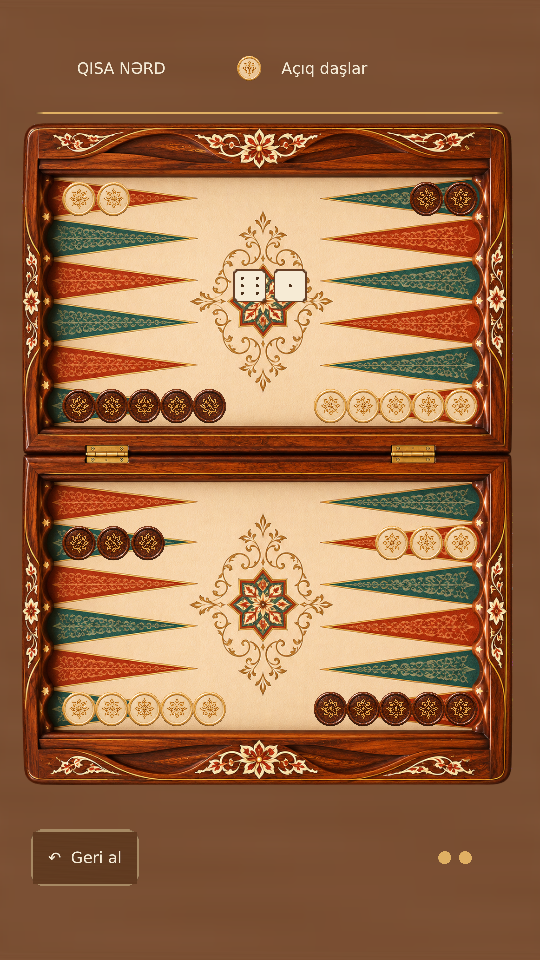

# P02.5 — şaquli və üfüqi matç yerləşimi

- Status: **AWAITING_HUMAN_APPROVAL**
- Tarix: 2026-11-04 / Asia/Baku
- İcazə: “P02.4 funksiyalarını qəbul edirəm; P02.5-də layout işinə başla.” (D033).
- P02.4 funksional qəbuldur; əvvəlki səhnə/HUD görünüşünün rəddi D032-də saxlanır.
- Yalnız P02.5 işlənib. P02.6/save, bot, online, başqa ekran və final polish yoxdur.

## Nəticə

Taxta artıq ekranın əsas hissəsidir. Ətrafdakı geniş krem sahə və böyük krem idarə paneli çıxarılıb;
sakit taxta səthi, taxtanın üstündə zərlər, sadə oyunçu statusu və kənarda material ailəsinə uyğun Undo istifadə olunur.
P0/P1, texniki indeks və işlənmiş/qalıq say izahları əsas səhnədə göstərilmir. Hüquqlar kiçik işarələrlə görünür.
İşləməyən “Gedişi tamamla” düyməsi yoxdur: son hüquq yenə avtomatik növbəni təsdiqləyir.
Zər atışı yalnız CanRoll zamanı aktivdir; həm atış idarəsinə, həm zərlərə toxunmaq mümkündür.
Sağ qalın off zolağı göstərilmir. Çıxarılan daşlar və hədəfləri yalnız lazım olanda kiçik yuva/say göstəricisi ilə çıxır.

Landşaftda taxta təbii üfüqi vəziyyətdədir. Portretdə həmin landşaft assetinin renderi 90° çevrilir;
daşlar, zərlər və mətnlər dik qalır. Taxta şəkli dartılmır, dairəvi daşlar sıxılmır. Bu, iki ayrıca HUD yerləşimidir.
Orijinal premium referans material üslubu kimi qalır; bütöv hazır səhnə kimi qəbul edilmir.
Dizaynın bəyənilməsi hələ insan qapısıdır, avtomatik PASS bunun əvəzi deyil.

## Kod sərhədi və fayllar

- MatchBoardLayout.cs: viewport/safe area, iki yerləşim, kanonik input xəritəsinin tərs çevrilməsi.
- MatchHudView.cs: mövcud snapshot/hüquqları göstərən board/HUD renderer; qayda və RNG hesablamır.
- BoardView.cs: yalnız ölçü/safe-area dəyişəndə yenidən yerləşmə; açıq preview ölçüləri üçün test yolu.
- BoardTurnInput.cs: çevrilmə kadrında köhnə koordinatlı drag ləğv edilir, saxta gediş yaranmır.
- ReferenceBoardSkin.cs: mövcud sprite-ləri paylaşan read-only property-lər; əvvəlki statik səhnə saxlanır.
- Yeni səhnə: unity/Assets/Game/Scenes/LayoutBoard.unity.
- Editor alətləri: P025Build.cs və P025Preview.cs; Tests/LayoutEditor və Tests/LayoutPlay testləri.
- Mövcud Rules/Match/Interaction, zər mənbəyi, əvvəlki C# testləri, GDD/Master və 87/20 qərar mətnləri dəyişmir.
- Yeni paket, xarici art xidməti və böyük asılılıq yoxdur. Taxta/daş PNG-ləri təkrar istifadə olunur;
  HUD materialı sadə orijinal kodla yaranır və asset manifestində qeyd edilir.

Screen ölçüsü/safe area runtime-da izlənir. Dönüş zamanı eyni LocalTurnLoop, immutable Session,
zər qiymətləri, istifadə maskası və Undo tarixçəsi saxlanır; yeni matç və ya atış yaradılmır.
Bu RAM-dakı yerləşim yeniləməsidir; tətbiqi bağlayıb bərpa etmək P02.6 işidir.

## Həqiqi test nəticələri

[İcra JSON-u və bütün 67 ID](P02.5.execution.json),
[EditMode XML](P02.5.editmode.xml), [PlayMode XML](P02.5.playmode.xml).

| Yoxlama | Nəticə |
|---|---|
| Unity import/compile | 0 C# xəta |
| EditMode | **777 PASS, 0 FAIL, 41 tarixi Ignore** |
| PlayMode | **22 PASS, 0 FAIL, 0 skip** |
| Yeni yerləşim testləri | 28 EditMode və 5 PlayMode |
| Əvvəlki regressiya | Əvvəlki 749 EditMode və 17 PlayMode PASS adı cari XML-də də PASS-dır |
| Qayda nümunələri | **67/67 PASS**; 26 uzun + 30 qısa + 7 matç + 4 Undo |
| Python / struktur | **118 PASS, 0 FAIL; 15/15 struktur PASS** — [Python logu](P02.5.tests.txt), [validator JSON](P02.5.validation.json) |
| Android | ARM64 IL2CPP development APK build PASS; apksigner v2, CRC və kitabxanalar PASS |
| Ayrı native Editor | GUI exit=0; drag/undo/yanlış drop/sürətli tap mərhələlərinin real state assert-ləri PASS |
| Fiziki Android / iOS / yerli oyunçu | **NOT_RUN** |

24 həndəsə kombinasiyası: 12 ölçü, hər birində full və notch safe area.
320×568, 390×844, 540×960, 720×1600, 768×1024, 1024×768, 960×540,
1600×720, 1920×1080, 2340×1080, 1080×2340 və 600×600 ölçüləri yoxlanıb.
Hər ölçüdə 24 xana, iki oyunçunun bar/off sahələri, ayrı idarələr, təbii board aspect,
board sahəsinin payı və tərs input xəritəsi yoxlanır. Yanlış ölçü üçün üç exception və safe-area fallback/clipping testi var.

PlayMode-da beş nisbətin real kamera renderi, 30 daşın safe-area sərhədləri və zərlə toqquşmaması yoxlanır.
Tap → Undo → resize → drag → commit ardıcıllığı eyni növbədə işləyir. Resize zamanı yarımçıq drag ləğv olunur.
İki yerləşimdə touch və multitouch, ekran/control sərhədi, həqiqi simulyasiyada çatılmış bar/off və bitmiş matç yoxlanır.
Oyunsonu çevrilmə əlavə atış və Undo açmır. Uzun stack-in eyni xanada örtüşməsi məqsədlidir və sayla göstərilir;
fərqli xana və zərlərlə səhv örtüşmə qəbul edilmir.

41 köhnə Ignore dəyişmir; onların 30-u ShortFixture, 7-si MatchFixture, 4-ü UndoFixture kimi ayrıca PASS-dır.
Ignore özlüyündə PASS deyil. Altı PROVISIONAL_RULE və müstəqil yerli təsdiq qapısı saxlanır.

## Real görüntülər

[Enli safe-area](../screenshots/P02.5-layout-wide-safe.png),
[uzun ekran](../screenshots/P02.5-layout-tall-safe.png),
[planşet](../screenshots/P02.5-layout-tablet.png),
[açıq növbənin portretə keçidi](../screenshots/P02.5-layout-portrait-moving.png),
[bar](../screenshots/P02.5-layout-short-bar.png),
[kiçik off yuvası](../screenshots/P02.5-layout-short-off.png),
[ayrıca native Game View](../screenshots/P02.5-editor-gameview.png).

Render ölçüləri: 960×540, 540×960, 1280×720, 720×1280 və 1024×768.
Safe-area önbaxışı və Input System sintetik Mouse/TouchState hadisələri istifadə olunur.
Bunlar real Unity renderidir; fiziki telefon sensoru, barmaq rahatlığı və DPI testi deyil.
Əmrlər [test matrisində](../TEST_MATRIX.md), raw loglar/XML və əlavə şəkillər ignored build/P02.5-dədir.

## Düzəlişlər və açıq risklər

İlk portret planşet halında idarələr sıxışırdı; UI miqyası uyğunlaşdırılmış board eninə bağlandı.
Board üçün ayrılmış yer planşetdə az olduğundan HUD boşluğu da həmin miqyasla hesablandı.
Böyük krem HUD panelləri çıxarıldı, zərlər taxtanın boş ortasına yerləşdirildi; zər/daş sərhədləri test edildi.
Kiçik ölçüdə zər küncləri həddən artıq yuvarlaq görünürdü; ayrıca daha kvadrat maska ilə düzəldilib yenidən göstərildi.
Düzəlişlərdən sonra bütün Unity testləri, build və ayrıca GUI sınağı təkrar real icra olunub.

**Köhnə Unity Analytics/WebRequest cleanup native SIGSEGV həll edilmiş sayılmır.**
Əvvəlki diaqnostika saxlanır. Cari üç batch və GUI exit=0 ilə bitib; bu icralarda qəza təkrarlanmayıb.
Səbəb və həll təsdiqlənməyib. Kritik sistem/driver/servis parametrləri dəyişməyib.
ADB-də bağlı fiziki cihaz yoxdur; Android orientation sensoru/rahatlıq testi və iOS build/device NOT_RUN-dır.
FPS, batareya, bütün telefonlarda uyğunluq və final art keyfiyyəti iddia edilmir.

## İnsan yoxlaması

1. Unity-də **NARD → P02.5 → Open responsive long match → Play** seçin. İlk atışları edin.
   Taxtanın böyük görünməsinə, boş krem sahənin və debug mətnlərinin çıxmasına baxın.
2. Game görünüşünü **Free Aspect** rejimində dar/uzun edin, sonra eninə böyüdün.
   Eyni daşlar, zərlər və növbə qalmalıdır. Pəncərəni ayrıca açıb ölçüsünü dəyişmək olar.
3. Bir gediş edin, görünüşü dəyişin və **Geri al** basın: daş və bir hüquq qayıtmalıdır.
   Daşı sürükləyərkən ölçünü dəyişin: buraxmada təsadüfi gediş yaranmamalıdır.
4. Qanuni addımları bitirin: növbə avtomatik keçməlidir. Saxta “Gedişi tamamla” düyməsi olmamalıdır;
   zər atışı yalnız növbə başlananda aktiv olmalıdır.
5. Stop edib **Open responsive short match → Play** ilə qısanı yoxlayın.
   Görünüşün oyun hissini ayrıca qiymətləndirin. Telefon qoşulanda APK ilə sensor/touch testi ayrıca aparılmalıdır.

APK: **build/P02.5/NARD-P02.5.apk** — **26,570,780 bayt**.
SHA-256: `d18ce58fe50a9a0021d2705969fa69d210eb8c0afafec34b13fcaf4f7abce7b8`.
Dəqiq ölçü/hash STATE və icra JSON-unda da saxlanır.
107 unikal meta GUID/sidecar və Git bütövlüyü yoxlanıb. Lokal commit yaradılır, GitHub-a push edilmir.
Heç bir Skill və qadağan olunmuş MCP istifadə edilməyib. Əlavə xidmət/ödəniş/server müdaxiləsi yoxdur.
**P02.5 insan təsdiqini gözləyir. P02.6-ya və başqa parta icazə yoxdur.**
